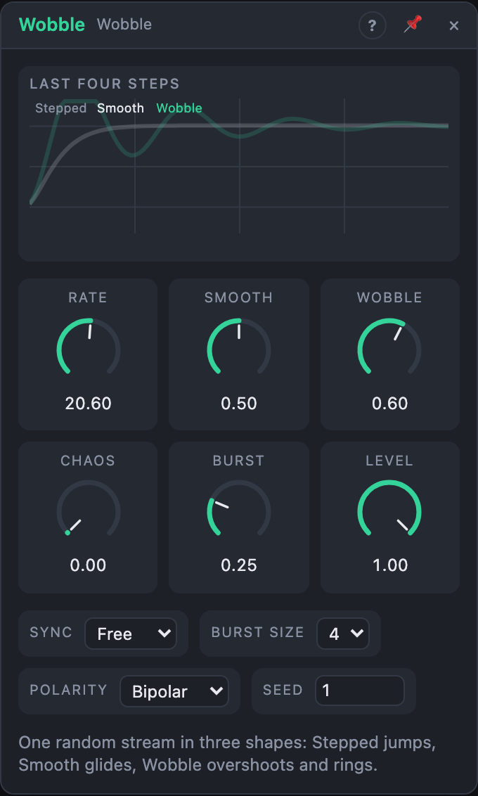

# Wobble

## Introduction

Wobble turns one stream of random values into three shapes of movement.
**Stepped** jumps to each new value, **Smooth** glides to it, and **Wobble**
glides with momentum: it overshoots, wobbles around the value and settles.
Patch them to related destinations (Stepped to pitch, Wobble to the filter)
and the movements belong together. Around them sit bursts of quick
triggers, a step clock, a *Compare* gate and a *Chaos* knob that feeds the
module back into itself.

## How does it work?

**Steps.** Wobble takes a new random value on each step. Steps come from:

1. **Clock patched:** every rising edge.
2. **Sync on a note value:** one step per note value. While the transport plays
   the steps are locked to the song position.
3. **Sync on Free:** steps at *Rate*.

Each step fires *Clock*. With *Sample* patched, each step samples that signal
instead of taking a random value: a sample and hold with three output shapes.
While *Hold* is high no new values are taken (and *Clock* stays quiet), but
Smooth and Wobble keep settling.

**Smooth** follows Stepped through a smooth low-pass filter. *Smooth* sets how
slowly: at 0 % it almost jumps, at 50 % it arrives just in time for the next
step, at 100 % it barely moves before the next value comes. The filter follows
the step length, so the character is the same at any rate or tempo.

**Wobble** uses the same filter with resonance. *Wobble* 0 % behaves like
Smooth; higher values overshoot each new value and ring around it. When the
next step comes before it settles, the wobbles overlap: that's where the
bouncing comes from. Beyond ±1 the output is softly limited to ±1.5.

**Burst.** On each step, with the chance *Burst*, a burst of 2 … *Burst Size*
quick triggers fires over the first half of the step: rolls for drums or
quick re-triggers of an envelope.

**Compare** is high while Stepped is above Smooth: an irregular gate whose
rhythm follows the movement.

**Chaos** feeds the module back into itself. The new values are bent toward
the current Smooth value and folded, so above about 40 % they cluster, run in
streaks and break away. In Free mode fast wobbles also speed up the steps, and
burst spacing gets irregular. Steps that follow the song position stay on the
grid.

**Repeatable.** The random values come from *Seed* and the step number. With
*Chaos* at 0 and *Sync* on a note value, Stepped is a function of the song
position. With *Chaos* up, a render from the same start position is always
identical.

## How to use it?

- **Three related movements:** *Stepped* to an oscillator's pitch (through a
  quantizer), *Wobble* to the filter cutoff, *Smooth* to the pan.
- **Bouncy filter:** *Wobble* 80 %, *Smooth* 40 %, Sync 1/8, into a filter's cutoff.
- **Slow drift:** *Smooth* 100 %, *Rate* 0.1 Hz: a wandering line.
- **One value per note:** inside a Voice Cell, *Voice In › Trigger* into *Clock*:
  every note gets a new value that wobbles into place.
- **Drum rolls:** *Burst* into a drum's trigger, *Burst* 30 %, Sync 1/4.
- **A sample and hold:** patch a signal into *Sample* and a clock into *Clock*.

## Demo patches

Five whole patches show what Wobble does. In the standalone app open **File → Presets…** (⌘P) and pick *Wobble* under *Demos by module*; loading one replaces the project and starts the transport.

| Patch | What it shows |
|---|---|
| **Wobble: Wandering Melody** | *Stepped* picks a new pitch every eighth through a Quantizer in D Dorian while *Wobble* springs the filter open; try *Chaos* and *Smooth*. |
| **Wobble: Bouncy Bass** | The *Wobble* output with a high *Wobble* amount bounces a ladder filter on a bass line at Sync 1/8. |
| **Wobble: Burst Rolls** | *Burst* fires quick rolls into a tom, *Stepped* retunes it and *Compare* opens the hats; raise *Burst* and *Burst Size*. |
| **Wobble: Drifting Pad** | At a slow *Rate* with *Smooth* at 100 %, the outputs drift a filter, pulse width and pitch of a held chord. |
| **Wobble: Sampled Arp** | A slow triangle LFO in *Sample* is read on every 1/16, so *Stepped* draws a staircase that a Quantizer turns into an arpeggio. |

## Reference

### Knobs and settings

| Control | Range | Default |
|---|---|---|
| Rate | 0.02 – 40 Hz | 1 Hz |
| Smooth | 0 – 100 % | 50 % |
| Wobble | 0 – 100 % | 60 % |
| Chaos | 0 – 100 % | 0 % |
| Burst | 0 – 100 % | 25 % |
| Level | 0 – 100 % | 100 % |
| Sync | Free, 1/32, 1/16, 1/8, 1/4, 1/2, 1 bar, 2 bars, 4 bars, 8 bars | Free |
| Burst Size | 2 – 8 | 4 |
| Polarity | Bipolar, Unipolar | Bipolar |
| Seed | 0 – 999 | 1 |

- **Rate:** steps per second, when *Sync* is *Free* and *Clock* is unpatched.
- **Smooth:** how slowly Smooth and Wobble follow the steps.
- **Wobble:** the resonance of the Wobble output.
- **Chaos:** feedback from the outputs into the values, the clock and the bursts.
- **Burst:** the chance of a burst on each step.
- **Level:** the size of Stepped, Smooth and Wobble.
- **Burst Size:** the most pulses a burst can have.
- **Polarity:** Bipolar −1 … +1, Unipolar 0 … 1.
- **Seed:** picks the sequence of values.

*Rate*, *Smooth*, *Wobble*, *Chaos*, *Burst* and *Level* are modulation destinations.

### Inputs

| Input | Signal | What it does |
|---|---|---|
| Clock | trigger | each pulse is a step; overrides *Rate* and *Sync* |
| Sample | control | when patched, each step samples it instead of a random value |
| Hold | gate | while high, no new values and no Clock pulses |

### Outputs

| Output | Signal | What it does |
|---|---|---|
| Stepped | control | the current value |
| Smooth | control | the values, glided without overshoot |
| Wobble | control | the values, glided with overshoot and ringing (±1.5 at most) |
| Burst | trigger | clusters of quick pulses |
| Clock | trigger | one pulse per step |
| Compare | gate | high while Stepped is above Smooth |
