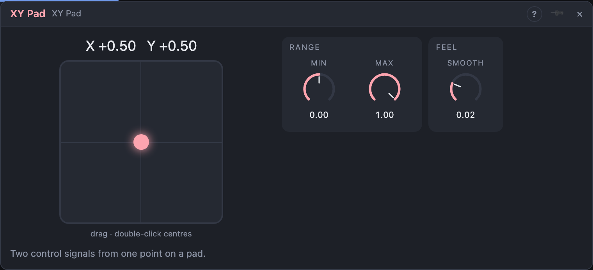

# XY Pad

## Introduction

The XY Pad gives you **two control signals from one touch**. Drag a point over
the pad: its horizontal position comes out of *X*, its vertical position out of
*Y*. Patch the two onto a filter's cutoff and resonance, or a pair of mix
knobs, and one finger plays both.

## How does it work?

*X* and *Y* go from **Min** at the left and bottom edges to **Max** at the right
and top edges; both axes share the range. The default is 0 to 1; set *Min* to
−1 for a pad that moves its destinations both ways from the centre.

**Smooth** glides both outputs to a new position instead of jumping.

A cable into the *X* or *Y* knob moves the point like a hand would. In a panel,
an XY pad control drives this module.

## How to use it?

- **Filter sweep:** *X* onto a Multi Filter's **Cutoff**, *Y* onto its **Resonance**.
- **Morph:** *X* and *Y* onto two Crossfader mixes for a four-way blend.

<!-- generated:demos -->
## Demo patches

Five whole patches show what XY Pad does. In the standalone app open **File → Presets…** (⌘P) and pick *XY Pad* under *Demos by module*; on the website, **Run in Play** opens one in your browser. Loading one replaces the project and starts the transport.

| Patch | What it shows |
|---|---|
| **XY Pad: Filter Plane** | The pad's X axis drives the cutoff and its Y axis the resonance of a saw bass, so dragging across the pad goes from dull to bright and up from smooth to squelchy. Drag the dot around while the groove runs. |
| **XY Pad: Echo Room** | X sets how much echo you hear and Y how many repeats it feeds back on a bell melody, so the bottom left is dry and the top right is a cloud of repeating notes. Try dragging along the edges to change only one thing at a time. |
| **XY Pad: Timbre Map** | X morphs the oscillator through its waveforms and Y changes its pulse width, so each corner of the pad is a different voice for the same slow tune. Park the dot in a corner or move it while the notes sound. |
| **XY Pad: Variation Field** | X controls the sequencer's Variation, the chance that notes are shifted away from the programmed ones, and Y its Gate Length, so you can shake up the tune and make it shorter or smoother at the same time. Park the pad low-left for the plain tune. |
| **XY Pad: Bipolar Range** | Min and Max are set to -1 and +1, so the pad's centre is zero: X bends the pitch a little either way and Y pushes the filter above or below its starting point. Narrow Min and Max for gentler moves. |
<!-- /generated -->

## Reference

### Knobs

| Knob | Range | Default |
|---|---|---|
| X | 0 – 100 % | 50 % |
| Y | 0 – 100 % | 50 % |
| Min | −1 – +1 | 0 |
| Max | −1 – +1 | +1 |
| Smooth | 0 – 2 s | 20 ms |

Every knob is a modulation destination.

### Outputs

| Output | Signal | What it does |
|---|---|---|
| X | control | horizontal position, scaled from *Min* to *Max* |
| Y | control | vertical position, scaled from *Min* to *Max* |
