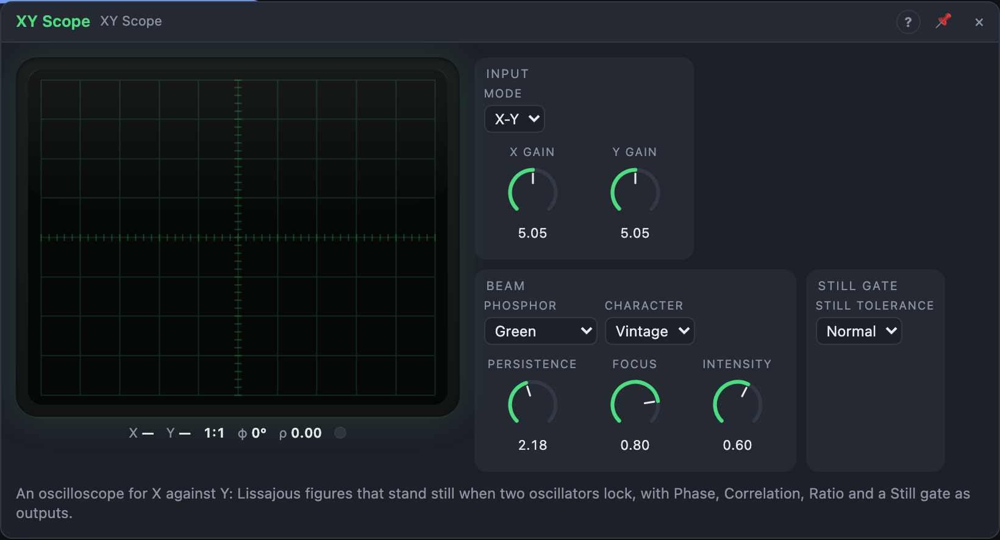

# XY Scope

## Introduction

XY Scope is an oscilloscope with a green phosphor screen, made for the old
bench trick of comparing two oscillators by eye. Patch one into **X** and one
into **Y**: the beam draws a Lissajous figure. It stands still when the two
are in a simple ratio and turns slowly when they are slightly off. A Y-T mode
shows ordinary waveforms.

It also turns what you see into signals: **Phase**, **Correlation**, **Ratio**
and a **Still** gate. Patch Still into a sequencer's clock and the music moves
on whenever two drifting oscillators happen to lock.

## How does it work?

**The screen.** X moves the beam left and right, Y up and down; at 1 × gain
±1 reaches the edge of the graticule. The beam glows where it moves slowly
and is faint where it moves fast, as on a real tube, and the trace fades
over *Persistence*. *Focus* sets how sharp the line is, *Intensity* how
bright, and the **Z** input modulates the brightness (−1 blanks the beam, +1
doubles it). *Character Vintage* adds the tube's flaws: a slightly bulging
picture, softer corners, a trace of mains hum and a short warm-up when the
view opens. None of this reaches the outputs.

**Frequencies.** Both inputs are measured by timing their rising zero
crossings, from about 0.2 Hz to 10 kHz. A channel counts as *valid* while it
is patched, louder than −60 dBFS and crossing zero at least every 5 s. The
readout shows both frequencies, or a dash while a channel is not valid.

**Ratio** is fy / fx as an interval: 1.0 is an octave, 0.585 a fifth, −1 an
octave down. From it the scope picks the **figure ratio** p:q, the simplest
fraction (up to 8:8) within 3 % of it; it shows in the readout and decides
what Phase compares. A new figure ratio takes over after 200 ms, so it
doesn't flicker between neighbours.

**Phase** is the phase of the figure, −1 … +1 for −180° … +180°. At 1:1 it is
the plain phase difference: 0 for a diagonal line, +0.5 for a circle with Y
leading, ±1 for the other diagonal. At other ratios it is constant as long
as Y is exactly p/q times X. When the oscillators drift apart, Phase becomes
a sawtooth at the rate the figure turns: two detuned oscillators make a slow
LFO from their own beating.

**Correlation** is +1 when X and Y move together, −1 when they move
opposite, and near 0 when they are unrelated or a quarter cycle apart.

**Still** goes high once the figure has stood still for 100 ms: both channels
valid, the ratio within 0.25 % of p/q and the figure turning slower than the
*Still Tolerance* (Tight 0.05, Normal 0.2, Loose 1 turn per second). It goes
low 50 ms after that stops being true. While a channel isn't valid, Ratio and
Phase hold their last value and Still is low.

**Y-T mode** draws Y over time, one sweep per *Timebase*. *Trigger Y Rising*
starts each sweep at a rising zero crossing of Y, so a steady wave stands
still; *Auto* does the same but sweeps anyway when no crossing comes;
*Beat* starts a sweep on every beat while the transport plays. X, when
patched, is drawn as a second, dimmer trace.

**Out X** and **Out Y** pass the inputs on unchanged, so the scope can sit in
a signal path. The scope has no random parts: the same input always gives the
same outputs.

## How to use it?

- **Tune by eye:** two oscillators into X and Y, tune one until the figure
  stands still. A circle or line is unison, a figure-eight an octave.
- **Beating as an LFO:** two oscillators a fraction of a hertz apart, *Phase*
  into a filter's cutoff: a slow sweep that speeds up as they drift apart.
- **Music that waits for a lock:** two free-running oscillators slightly
  detuned (or slowly modulated), *Still* into a sequencer's clock.
- **Stereo width:** a stereo signal's left and right into X and Y. A line at
  45° is mono, a round cloud is wide; *Correlation* below 0 warns of phase
  problems.
- **Interval follower:** *Ratio* into an oscillator's pitch makes it follow
  the interval between two others.
- **Classic scope:** Mode Y-T, any signal into Y.

<!-- generated:demos -->
## Demo patches

Five whole patches show what XY Scope does. In the standalone app open **File → Presets…** (⌘P) and pick *XY Scope* under *Demos by module*; on the website, **Run in Play** opens one in your browser. Loading one replaces the project and starts the transport.

| Patch | What it shows |
|---|---|
| **XY Scope: Locked Fifth Knot** | Two sines a fifth apart draw a slow-turning knot on the scope; each time the pattern stands still enough, the Still gate fires a bell. Change Still Tolerance to Loose and the bells come more often, or tune the Y oscillator by ear to lock them. |
| **XY Scope: Stereo Width Pad** | A pad's left and right channels go into X and Y, so the scope shows the stereo image: a diagonal line means near-mono, a round cloud means wide. The Correlation output opens the reverb when the image narrows. Turn the Chorus's Spread down and watch the cloud pinch. |
| **XY Scope: Bass Waveform** | In Y-T mode the scope is an ordinary oscilloscope: a bass line's waveform stands still on screen, triggered on every rising edge. Shorten Timebase to see single cycles, or turn the Oscillator's Shape and watch the wave change under the sound. |
| **XY Scope: FM Knots** | A bell-like FM pair plays a pentatonic line; the carrier goes to X and the modulated tone to Y, so each note draws a tangled knot that unwinds as it decays. Raise the Oscillator's FM Depth for a busier knot, or X Gain to stretch the figure. |
| **XY Scope: Ratio Plays a Voice** | A fixed sine on X and a sweeping sine on Y: the scope measures their ratio and its Ratio output, as a pitch, plays a third voice that follows the interval between them. Change the sweep rate and the follower glides along; try Timebase for a clearer picture. |
<!-- /generated -->

## Reference

### Knobs and settings

| Control | Range | Default |
|---|---|---|
| X Gain | 0.1 – 10 × | 1 × |
| Y Gain | 0.1 – 10 × | 1 × |
| Timebase | 1 ms – 2 s | 20 ms |
| Persistence | 10 ms – 5 s | 150 ms |
| Focus | 0 – 100 % | 80 % |
| Intensity | 0 – 100 % | 60 % |
| Mode | X-Y, Y-T | X-Y |
| Trigger | Y Rising, Auto, Beat | Y Rising |
| Phosphor | Green, Amber, Blue-White | Green |
| Character | Clean, Vintage | Vintage |
| Still Tolerance | Tight, Normal, Loose | Normal |

- **X Gain, Y Gain:** the size of the picture across and up.
- **Timebase:** the length of one sweep (Y-T mode only).
- **Persistence:** how long the trace glows: the time it takes to fade by 40 dB.
- **Focus:** 100 % is a fine line, 0 % a soft, wide glow.
- **Intensity:** the beam's brightness.
- **Trigger:** what starts a sweep (Y-T mode only).
- **Phosphor:** the screen colour.
- **Character:** Vintage adds the tube's flaws, Clean draws none.
- **Still Tolerance:** how slowly the figure must turn for *Still*.

The six knobs are modulation destinations. Only *Timebase* (in Y-T mode)
changes anything but the picture; the others never touch the outputs.

### Inputs

| Input | Signal | What it does |
|---|---|---|
| X | audio | horizontal deflection; the reference for Phase and Ratio |
| Y | audio | vertical deflection; the signal compared with X |
| Z | control | beam brightness: 0 normal, −1 off, +1 double |

### Outputs

| Output | Signal | What it does |
|---|---|---|
| Out X | audio | X, unchanged |
| Out Y | audio | Y, unchanged |
| Phase | control | the figure's phase, −1 … +1 = −180° … +180° |
| Correlation | control | how alike X and Y are, −1 … +1 |
| Ratio | pitch | fy / fx as an interval (1.0 = an octave) |
| Still | gate | high while the figure stands still |
