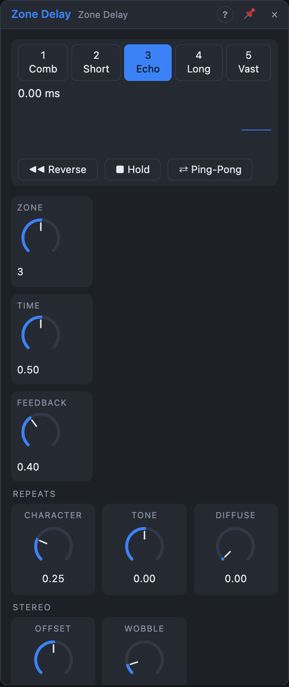

# Zone Delay

## Introduction

Zone Delay is one stereo delay for every delay time worth having: tuned combs
and flanging, doubling and slapback, rhythmic echoes and loops of up to 20
seconds. *Zone* picks the time range and *Time* moves within it. The other
knobs shape what happens to the repeats: how they sound, how much they smear
into a cloud and how they move across the stereo field. Three switches turn it
into a performance instrument: **Reverse**, **Hold** and **Ping-Pong**.

## How does it work?

**Zones.** Each zone is a time range; *Time* moves through it exponentially.

| Zone | Name | Free range | Synced values |
|---|---|---|---|
| 1 | Comb | 0.25 – 12 ms | – (follows *Pitch*) |
| 2 | Short | 8 – 120 ms | 1/128 … 1/32 |
| 3 | Echo | 80 ms – 1.2 s | 1/32 … 1/2 |
| 4 | Long | 0.6 – 5 s | 1/4 … 2 bars |
| 5 | Vast | 3 – 20 s | 1 bar … 8 bars |

The view prints the actual time. With *Sync* on *Transport*, *Time* steps
through the zone's note values (straight, dotted and triplet) at the song's
tempo. With a cable in **Clock**, the time is the interval between the last
two pulses, and *Time* picks a ratio of it (¼, ⅓, ½, ⅔, 1, 3/2, 2, 3, 4).
In the **Comb** zone with a cable in **Pitch**, the delay is tuned to that
note (*Time* becomes ±12 semitones), so a Voice Cell's pitch plays the comb in
tune.

**Time changes.** *Time Change* decides what happens when the time moves:

- **Tape:** the read head glides to the new time (*Glide*), so the repeats
  bend in pitch like a tape echo. Modulating *Time* fast gives FM-like
  wobbles, always without clicks.
- **Crossfade:** a second head jumps to the new time and the two crossfade
  (30 ms in Comb and Short, 60 ms in Echo, 120 ms in Long and Vast). The pitch
  never changes; fast modulation becomes stepped.

**The repeats.** *Feedback* sets how much of each repeat comes back; above
100 % the loop grows until the character's saturation holds it, a stable,
compressed drone. *Character* morphs through five loop sounds:

| Character | Sound |
|---|---|
| 0 % Clean | flat, only a 20 kHz low-pass |
| 25 % Tape | 7 kHz low-pass, 40 Hz high-pass, soft saturation, a little hiss |
| 50 % Dark | 2.2 kHz low-pass, 120 Hz high-pass, gentle saturation |
| 75 % Band | a band-pass at 1 kHz: telephone repeats |
| 100 % Lo-Fi | 12 kHz sample-rate reduction, 10 bits, 5 kHz low-pass |

Positions in between blend two neighbours. The character colours every pass,
so later repeats are darker or dirtier than early ones. *Tone* moves all its
filters up or down by up to two octaves. **Diffuse** adds allpass diffusion in
the feedback path: the first echo stays clear, later ones dissolve into a
cloud; at 100 % with high feedback it becomes a reverb with the delay time as
its pre-delay.

**Stereo.** *Offset* makes the right side's time longer (positive) or shorter
(negative) than the left's. *Wobble* adds slow tape wow and a little flutter,
chorus-like in the short zones and subtle in the long ones. **Ping-Pong**
crosses the feedback over, and the first repeat starts on the left only, so
even a mono source bounces from side to side.

**Reverse** plays the last *Time* worth of audio backwards in overlapping
windows; the reversed sound is fed back, so repeats alternate direction.
**Hold** stops recording and loops what is in the buffer, without any loss;
*Time* then changes the loop's speed (Tape) or its length (Crossfade), and
Reverse plays the held loop backwards. Release Hold and the input comes back.
The three buttons in the view latch; the gate inputs work while high.

**Tails and renders.** Stopping the transport leaves the echoes ringing. With
*Clear on Play* the buffer is emptied when the transport starts, so renders
start from silence and repeat exactly; Wobble restarts from *Seed* either way.

## How to use it?

- **Dub echo:** Zone 3, *Sync* on *Transport*, Time on 1/8., Feedback 70 %,
  Character 30 %. Ride *Tone* and *Feedback* by hand.
- **Karplus pluck in a Voice Cell:** Zone 1, *Pitch* from *Voice In › Pitch*,
  a short noise burst into *In L*, Feedback 95 %, Mix 100 %.
- **Flanger:** Zone 1 without *Pitch*, an LFO on *Time*, Feedback 60 %.
- **Tape-stop scratches:** Tape mode with a short Glide, a stepped random
  source on *Time*.
- **Looper:** Zone 5, Mix 50 %, press *Hold* to keep a phrase; *Reverse* plays
  it backwards.
- **Ambient wash:** Zone 4, Feedback 90 %, Diffuse 80 %, Wobble 40 %.

## Demo patches

Five whole patches show what Zone Delay does. In the standalone app open **File → Presets…** (⌘P) and pick *Zone Delay* under *Demos by module*; loading one replaces the project and starts the transport.

| Patch | What it shows |
|---|---|
| **Zone Delay: Dub Echo** | *Zone* 3 with *Sync* on *Transport* and a tape *Character*; a square LFO on the *Ping-Pong* gate bounces the repeats. |
| **Zone Delay: Tuned Combs** | *Zone* 1 (Comb) tuned by the *Pitch* input, with high *Feedback*: a sequencer plays resonant, string-like rings. |
| **Zone Delay: Vast Hold Loop** | *Zone* 5 is a multi-bar loop; LFOs on the *Hold* and *Reverse* gates freeze and flip what is in the buffer. |
| **Zone Delay: Tape Dive** | *Time Change* *Tape* with a long *Glide* and a stepped random source on *Time*: every jump bends the echoes. |
| **Zone Delay: Diffuse Cloud** | Full *Diffuse* and high *Feedback* in the Long zone melt the repeats of a drum groove into a cloud; *Offset* widens it. |

## Reference

### Knobs

| Knob | Range | Default |
|---|---|---|
| Zone | 1 – 5 (stepped) | 3 |
| Time | 0 – 100 % of the zone | 50 % |
| Feedback | 0 – 110 % | 40 % |
| Character | 0 – 100 % | 25 % |
| Tone | −1 … +1 | 0 |
| Diffuse | 0 – 100 % | 0 % |
| Offset | −50 … +50 % | 0 % |
| Wobble | 0 – 100 % | 10 % |
| Mix | 0 – 100 % | 35 % |

Every knob is a modulation destination.

### Settings

| Setting | Values | Default |
|---|---|---|
| Sync | Free, Transport | Free |
| Time Change | Tape, Crossfade | Tape |
| Glide | 5 ms – 2 s (Tape) | 150 ms |
| Clear on Play | Off, On | Off |
| Seed | 0 – 999 | 1 |

### Inputs

| Input | Signal | What it does |
|---|---|---|
| In L, In R | audio | the input; *In L* alone feeds both sides |
| Clock | trigger | the time is the pulse interval × the ratio *Time* picks |
| Pitch | pitch | Comb zone: tunes the delay to the note |
| Reverse | gate | repeats play backwards while high |
| Hold | gate | the buffer loops while high |
| Ping-Pong | gate | repeats bounce between the sides while high |

### Outputs

| Output | Signal | What it does |
|---|---|---|
| Out L, Out R | audio | dry and wet mixed by *Mix* |
| Wet L, Wet R | audio | the repeats only |
| Tap | trigger | a pulse each time the delay time elapses |

The delay holds 30 seconds per side (about 16 MB at 48 kHz), so put it after a
Voice Cell rather than inside one.
